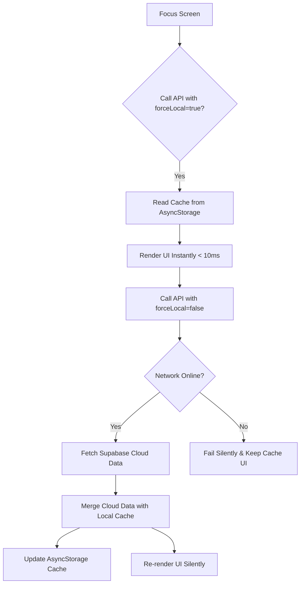

# FallTrack Mobile Application - Developer & User Documentation

This document serves as the complete system guide, architectural overview, and workflow manual for the **FallTrack Mobile Application**. It outlines the technology stack, existing vs. proposed systems, step-by-step user flows, local-first cache architectures, and synchronization engines.

---

## 📖 1. Project Overview

The **FallTrack Mobile App** is a lightweight, offline-first production ledger built for saree fall workers and managers. It allows users to record daily saree fall counts, select colors using a phonetic search algorithm, calculate piece-rate wages dynamically based on effective dates, track billing cycles, and export high-contrast PDF/CSV invoices. 

Designed to operate in areas with poor cellular coverage, the application utilizes a **local-first data cache** (via `AsyncStorage`) and a **silent background synchronization engine** to merge local edits with a cloud-hosted Supabase database.

---

## 🔄 2. Existing vs. Proposed System

| Dimension | Existing System (Traditional/Paper Ledger) | Proposed System (FallTrack Mobile) |
| :--- | :--- | :--- |
| **Data Recording** | Hand-written logs in paper notebooks. Prone to damage, miscalculations, and loss. | Digital inputs stored locally on the phone's database. |
| **Mobility & Off-grid** | Handbooks are portable but cannot aggregate reports or share records digitally. | Works fully offline. Stores logs locally and auto-syncs when internet is available. |
| **Conflict Resolution** | Frequent disputes between managers and workers regarding bundle counts. | Read-only historical logs locked after the calendar day ends to prevent alterations. |
| **Loading Speeds** | Web-only access requires waiting for slow REST queries over cellular connections. | **Cache-First Loading**: App pulls local logs in under 10ms; refreshes online silently in the background. |
| **Authentication** | Connection drops lock the user out of their cloud portal. | **Fail-Safe Auth**: Caches credentials locally; logs in offline if Supabase is unreachable. |

---

## 🛠️ 3. Technology Stack

* **Frontend Framework**: React Native (0.81.5) via Expo (v54).
* **Programming Language**: TypeScript (v5.9) with strict type safety.
* **Database & Cloud Backend**: Supabase JS Client (v2) for remote cloud storage.
* **Local Storage Cache**: AsyncStorage (v2) acting as the offline database container.
* **Navigation**: React Navigation v7 (Bottom Tab Navigator).
* **UI & Styles**: Native StyleSheet layout with HSL colors, responsive design systems, and Lucide icons.
* **Document Engines**: Expo Print & Sharing for generating and printing high-fidelity PDF invoices.

---

## 🚶 4. Application Flow: First to Last

### 🚀 Step 1: Boot & Custom Splash Screen
1. When launched, the app mounts the animated splash screen in [App.tsx](file:///d:/FallTrack/mobile/App.tsx).
2. The splash screen fades in and scales the logo, displaying an active loading indicator and the build version (e.g., `VERSION 1.0.6`).
3. **Safety Margin**: The version label is styled with `bottom: 80` to sit comfortably above Android's physical or virtual navigation buttons.
4. During this animation, the app queries the local storage auth session. If a valid session exists, it routes to the **Main Dashboard**; otherwise, it opens the **Login Screen**.

### 🔐 Step 2: Resilient Authentication (Login Screen)
1. The user inputs their email and password in [LoginScreen.tsx](file:///d:/FallTrack/mobile/src/screens/LoginScreen.tsx).
2. **Online Sign-In**: The app attempts to authenticate against Supabase. On success, it creates a local hash of the password (`passwordHash`) and caches it along with user details in AsyncStorage.
3. **Offline Fallback**: If the network times out or drops (raising a `"Network request failed"` error), the app bypasses Supabase and validates the credentials against the cached local `passwordHash`. If it matches, login is granted offline.

### 📊 Step 3: Main Dashboard Tab
1. Once logged in, the user sees the **DashboardScreen** ([DashboardScreen.tsx](file:///d:/FallTrack/mobile/src/screens/DashboardScreen.tsx)).
2. **Instant Cache Render**: The screen first pulls profile info, active rates, production logs, and billing cycles from local storage in **under 10ms**, dismissing the loading spinner instantly.
3. **Background Update**: A background routine calls Supabase. If the connection is online, it retrieves fresh data, merges it locally, and updates the screen stats silently without freezing the UI.
4. Displays:
   - Today's saree fall count.
   - Monthly/Cycle earnings.
   - Estimated payout based on active date-specific rates.
   - List of recent logs.

### ✍️ Step 4: Daily Entry Tab (Log Production)
1. Tapping the **Daily Entry** tab opens [DailyEntryScreen.tsx](file:///d:/FallTrack/mobile/src/screens/DailyEntryScreen.tsx).
2. **Historical Locking**: The date picker is disabled and styled as read-only. Logs can only be written for the **current calendar day** to prevent accidental modifications to past ledgers.
3. **Keyboard Avoidance**: Wrapped inside a `<KeyboardAvoidingView>`, the form shrinks automatically when the keyboard slides up.
4. **Auto-Scroll Assist**: When the user adds a new row or taps a quantity input field, the list automatically scrolls to the bottom, keeping the active input visible above the keyboard.
5. **Phonetic Color Picker**: Tapping "Select Color..." opens a modal that allows users to type Marathi spellings in English letters (e.g., typing `lal` matches `लाल`, `keshari` matches `केशरी`). If a new color is typed, the user can create it inline.
6. Saving records writes them to local storage instantly and sends them to the sync queue.

### 📜 Step 5: History Tab
1. The **HistoryScreen** ([HistoryScreen.tsx](file:///d:/FallTrack/mobile/src/screens/HistoryScreen.tsx)) lists all logs grouped chronologically.
2. **Record Locking**: The **Delete** button is hidden for all logs except those created today. Past records are locked from edits or deletions.

### 💰 Step 6: Income Tracker Tab
1. The **IncomeTrackerScreen** ([IncomeTrackerScreen.tsx](file:///d:/FallTrack/mobile/src/screens/IncomeTrackerScreen.tsx)) lists all past custom billing cycles (e.g., Fortnightly or Monthly periods).
2. Users can create a new billing cycle by selecting an end date. The start date is automatically resolved based on the end of the previous period.

### ⚙️ Step 7: Settings Tab
1. The **SettingsScreen** ([SettingsScreen.tsx](file:///d:/FallTrack/mobile/src/screens/SettingsScreen.tsx)) allows configuring profile details (Manager name, phone), rate changes, color catalog edits, and exporting reports.
2. **Report Exports**: Generates CSV or PDF documents for any selected date range.
   - **PDF Enhancements**:
     - Displays `Name: Shrikant Kalekar` instead of `Manager:`.
     - Displays raw dates (e.g., `03/07/2026 to 01/08/2026`) in the Cycle Range without the prefix label.
     - Displays the active billing month (e.g., `July-2026`) centered directly below the header orange line.

---

## 🔀 5. Cache-First Synchronization Engine

The application implements a custom offline synchronization flow within [dbService.ts](file:///d:/FallTrack/mobile/src/services/dbService.ts):



### Row-Level Sync Tracker
All records contain a `synced` boolean flag. 
* When a log is added offline, `synced` is set to `false`.
* The background engine regularly attempts to push rows where `synced === false` to Supabase.
* Once successfully written to the cloud, the local row is updated with `synced = true`.

---

## 📂 6. File Directory Map (Mobile)

* **Root Directory**:
  - [App.tsx](file:///d:/FallTrack/mobile/App.tsx) - Main entry router, auth monitor, and animated splash screen.
  - [package.json](file:///d:/FallTrack/mobile/package.json) - Mobile dependencies and NPM scripts.
* **Source Directory (`mobile/src/`)**:
  - `types/index.ts` - TypeScript interfaces for `Color`, `Rate`, `ProductionEntry`, `Profile`, and `IncomePeriod`.
  - **Screens (`mobile/src/screens/`)**:
    - [LoginScreen.tsx](file:///d:/FallTrack/mobile/src/screens/LoginScreen.tsx) - Authentication forms and offline hash auth.
    - [DashboardScreen.tsx](file:///d:/FallTrack/mobile/src/screens/DashboardScreen.tsx) - Main landing grid and summary cards.
    - [DailyEntryScreen.tsx](file:///d:/FallTrack/mobile/src/screens/DailyEntryScreen.tsx) - Form rows list, custom date header, and phonetic search.
    - [HistoryScreen.tsx](file:///d:/FallTrack/mobile/src/screens/HistoryScreen.tsx) - Logs lists, date range filtering, and locked item deletions.
    - [IncomeTrackerScreen.tsx](file:///d:/FallTrack/mobile/src/screens/IncomeTrackerScreen.tsx) - Billing period creator.
    - [SettingsScreen.tsx](file:///d:/FallTrack/mobile/src/screens/SettingsScreen.tsx) - Backup options, color lists, rate edits, and PDF exports.
  - **Services (`mobile/src/services/`)**:
    - [dbService.ts](file:///d:/FallTrack/mobile/src/services/dbService.ts) - Sync manager, AsyncStorage interfaces, and Supabase client hooks.
  - **Utilities (`mobile/src/utils/`)**:
    - `theme.ts` - Font families, text colors, and styling rules.
    - `dateFormatter.ts` - Standard date converters.
    - [reportExport.ts](file:///d:/FallTrack/mobile/src/utils/reportExport.ts) - HTML PDF generator and mobile sharing integrations.
    - `transliterate.ts` - Devanagari phonetic converter.

---

## 💻 7. Development & Build Commands

Run these commands inside the `mobile` workspace directory:

* **Install Dependencies**:
  ```bash
  npm install
  ```
* **Start Metro Bundler**:
  ```bash
  npm start
  ```
* **Run Android Build (Local Emulator)**:
  ```bash
  npm run android
  ```
* **Compile and Build Release APK**:
  ```bash
  npm run build:apk
  ```
  *Bumps the patch version, creates compilation assets, and outputs the release binary at `/android/app/build/outputs/apk/release/app-release.apk`.*


Here is a detailed explanation of why Supabase pauses your project, its impact on the system, and how you can permanently avoid it in the future.

---

### 1. Why does Supabase pause the project?
Supabase hosts your database on a virtual server. If you are on the **Supabase Free Tier**:
* **Inactivity Rule**: Supabase will automatically pause your project if it receives **no database activity or API requests for 7 consecutive days (1 week)**.
* **Why they do it**: Since it is a free service, Supabase pauses inactive projects to free up server resources for other active users.

---

### 2. What is the impact when it is paused?
* **Web Dashboard**: The website will **not open** or will display a database connection error, because the website requires a live connection to Supabase to fetch profiles, rates, and logs.
* **Mobile Application**:
  * **First-Time Users / Logouts**: If a user is not logged in or is trying to log in on a new phone, they will receive a network connection error because the auth server is paused.
  * **Logged-In Users (Offline Mode)**: Thanks to our **offline-first local caching** and **resilient offline auth fallback**, users who are already logged in can still open the app, log saree falls, view logs, and track income completely offline! 
  * However, their local logs will remain queued on the phone and **will not sync to the cloud** until the Supabase project is unpaused.

---

### 3. How to avoid this problem in the future?

There are two primary ways to prevent your project from pausing:

#### Option A: Upgrade to the Pro Tier (Recommended for production)
* **Cost**: $25 / month.
* **How it works**: Upgrading to the Supabase Pro tier **permanently disables project pausing**. Your database and APIs will stay online 24/7/365, even if there is no activity for months.
* **How to do it**: Go to your [Supabase Dashboard](https://supabase.com/dashboard), click on **Project Settings** -> **Subscription**, and upgrade to the Pro plan.

---

#### Option B: Automate a Free Weekly "Ping" (Keep it free)
If you want to keep using the Free Tier, you must send at least one database request to Supabase every 7 days. You can automate this for free:

1. **Use UptimeRobot (Easiest)**:
   * Go to [UptimeRobot.com](https://uptimerobot.com/) (which is free).
   * Create a new monitor of type `HTTP(s)`.
   * Set the URL to your Supabase project URL (e.g., `https://your-project-id.supabase.co/rest/v1/`).
   * Set the monitoring interval to **every 24 hours** or **every 7 days**.
   * This will send a free automated ping to your Supabase API every day, counting as active database traffic, and **your project will never be paused again**.

2. **Use a Free GitHub Action**:
   * We can write a simple automation script in GitHub that runs a scheduled cron job (e.g., every Monday morning) to ping your Supabase API. This keeps the project alive indefinitely for free.

Please let me know if you would like me to help you set up the free automated ping or if you have any questions about upgrading!